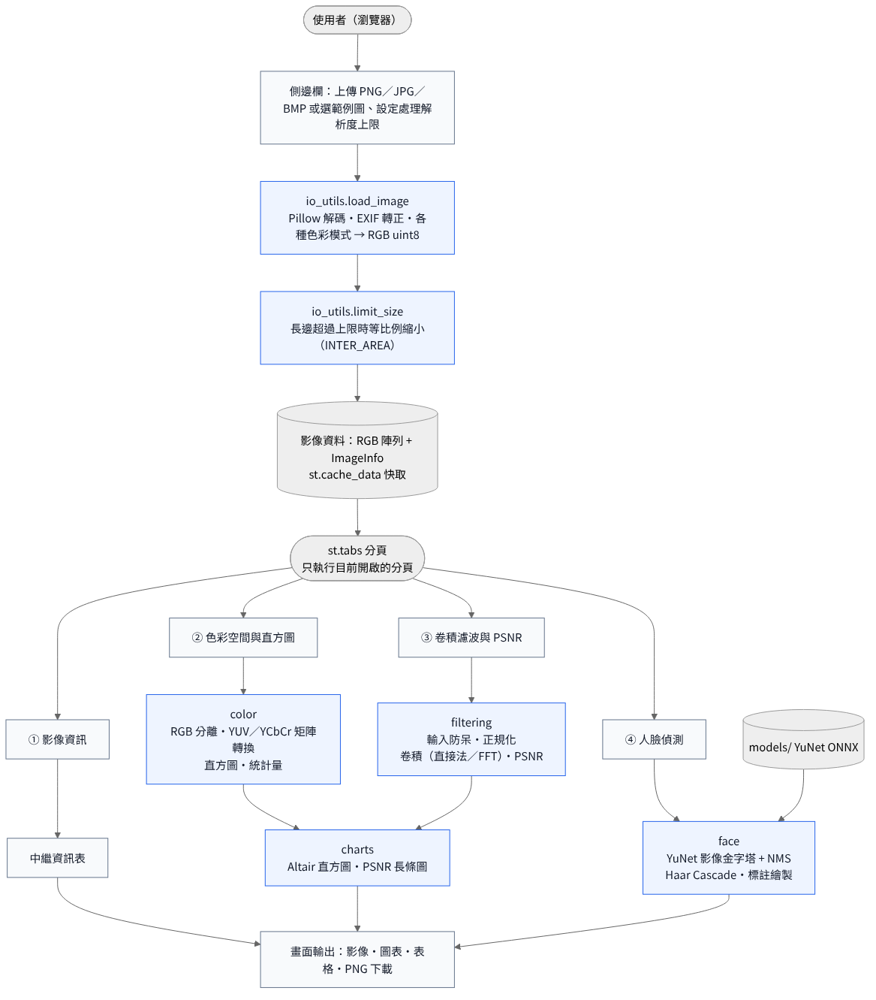
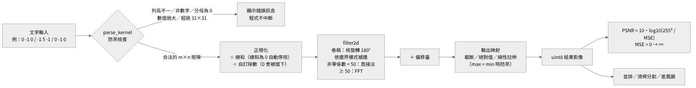
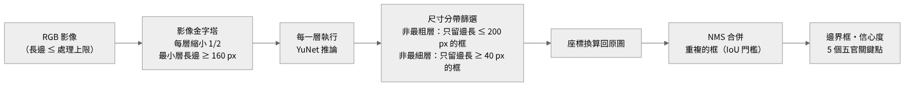

# AI 影像處理與人臉分析工具

以 Streamlit 製作的互動式影像處理網頁應用，包含四大功能：影像載入與中繼資訊解析、RGB／YUV 色彩空間與同步直方圖、自訂卷積核濾波與 PSNR 評估、YuNet／Haar 人臉偵測。

色彩轉換、直方圖、卷積與 PSNR 都以 NumPy 自行實作，並用 OpenCV、SciPy、scikit-image 的結果交叉驗證。專案共有 300 項自動測試，在 Python 3.11、3.12、3.13 上全部通過。

| 項目 | 連結 |
|---|---|
| 線上展示（Live Demo） | `https://＜你的 App 名稱＞.streamlit.app` |
| 原始碼（GitHub） | `https://github.com/＜你的帳號＞/ai-image-face-tool` |

> 部署完成後，把上表換成實際網址，並在 `app.py` 開頭的 `SOURCE_CODE_URL` 填入 GitHub 網址（側邊欄就會出現「原始碼」按鈕）。

## 功能總覽

| 功能 | 內容 | 主要程式 |
|---|---|---|
| ① 影像載入與解析 | 支援 PNG、JPG/JPEG、BMP；顯示解析度、色彩模式、通道數、位元深度、檔案大小、未壓縮資料量與壓縮率、DPI、EXIF 方向 | `imgtool/io_utils.py` |
| ② 色彩空間與直方圖 | 原始影像／R／G／B／Y／U／V 七種檢視，切換時同步更新直方圖（橫軸像素強度 0–255、縱軸像素數量）與統計量；可切換 BT.601 YUV／YCbCr、偽彩色、對數刻度 | `imgtool/color.py`、`imgtool/charts.py` |
| ③ 卷積濾波與 PSNR | 文字輸入任意 m×n 卷積核、16 種預設範本、高斯核產生器；正規化、偏移量、輸出映射、5 種邊界處理；並排／滑桿分割／差異圖比對；PSNR、MSE、各通道 PSNR、全部範本批次比較 | `imgtool/filtering.py` |
| ④ 人臉偵測 | YuNet（輕量 CNN，影像金字塔多尺度偵測）與 Haar Cascade；標出邊界框、人臉數量、信心度與五官關鍵點，可下載標註結果 | `imgtool/face.py` |

## 介面截圖


`docs/screenshots/` 內的完整截圖：

| 檔案 | 畫面 |
|---|---|
| `01_info.png` | ① 影像資訊：中繼資訊表 |
| `02_color_original.png` | ② 原始影像與 RGB 疊合直方圖 |
| `03_color_v_pseudo.png` | ② V 色度分量（偽彩色）與截斷提示 |
| `04_color_overview.png` | ② RGB／YUV 六個分量並排總覽 |
| `05_filter_side_by_side.png` | ③ 銳化，並排比較 |
| `06_filter_split.png` | ③ 滑桿分割比對 |
| `07_filter_diff.png` | ③ 差異圖（×4） |
| `08_filter_sobel.png` | ③ Sobel 邊緣偵測（取絕對值） |
| `09_filter_emboss.png` | ③ 灰色浮雕（偏移量 128） |
| `10_kernel_error.png` | ③ 防呆：列長不一的錯誤訊息 |
| `11_zero_sum_warning.png` | ③ 防呆：總和為 0 時自動停用「除以總和」 |
| `12_psnr_batch.png` | ③ PSNR 公式與 16 種濾波器批次比較 |
| `13_face_no_face.png` | ④ 範例圖沒有人臉時的提示 |
| `14_edge_large_image.png` | 6000×4000 大圖自動縮小 |
| `15_edge_corrupted.png` | 損毀檔的錯誤訊息 |
| `16_edge_rgba.png` | 透明背景 PNG（Alpha 合成） |
| `17_edge_exif.png` | EXIF 旋轉自動轉正 |

## 1. 開發環境與安裝

- 開發語言：Python 3.12（已測試 3.11、3.12、3.13；Streamlit Cloud 預設 3.12）
- 作業系統：Windows 10/11、macOS（Apple Silicon；Intel Mac 需 macOS 14 以上）、Linux

### requirements.txt 條目說明

| 套件 | 版本 | 用途 |
|---|---|---|
| `streamlit` | 1.66.1 | 互動網頁介面：分頁、上傳、滑桿、運算結果快取 |
| `opencv-python-headless` | 4.14.0.94 | YuNet／Haar 人臉偵測、影像縮放與標註繪製。headless 版不依賴桌面 GUI 函式庫，適合雲端部署 |
| `numpy` | 2.4.6 | 色彩轉換、直方圖、卷積、PSNR 等核心運算（支援 Python 3.11–3.14） |
| `pillow` | 12.3.0 | 影像解碼與中繼資訊（色彩模式、EXIF、DPI） |
| `pandas` | 3.0.5 | 資訊表格與統計表 |
| `altair` | 6.3.0 | 直方圖與 PSNR 長條圖 |

版本全部鎖定，確保本機與雲端安裝到相同版本。OpenCV 刻意停在 4.x，原因有兩個：

- opencv-python-headless 5.0 拿掉了 Haar 用的 `CascadeClassifier`。
- 本專案的 YuNet 2023mar 模型是固定輸入尺寸，需要 OpenCV 4.x 的 DNN 引擎才能接受任意大小的影像。

`requirements-dev.txt` 另外列出測試用的 pytest、SciPy、scikit-image。這三個只用來交叉驗證演算法，部署時不需要安裝。

### 本機執行

Windows（PowerShell）：

```powershell
cd ai-image-face-tool
py -3.12 -m venv .venv
.\.venv\Scripts\Activate.ps1
python -m pip install --upgrade pip
pip install -r requirements.txt
streamlit run app.py
```

如果 PowerShell 顯示「已停用指令碼執行」，先執行：

```powershell
Set-ExecutionPolicy -Scope CurrentUser -ExecutionPolicy RemoteSigned
```

macOS／Linux：

```bash
cd ai-image-face-tool
python3.12 -m venv .venv
source .venv/bin/activate
python -m pip install --upgrade pip
pip install -r requirements.txt
streamlit run app.py
```

執行後瀏覽器會自動開啟 <http://localhost:8501>。

### 執行測試

```bash
pip install -r requirements-dev.txt
python -m pytest
```

## 2. 專案結構

```text
ai-image-face-tool/
├── app.py                   Streamlit 主程式（四個分頁的介面）
├── imgtool/                 核心演算法套件（不依賴 Streamlit，可單獨測試）
│   ├── io_utils.py          功能 1：讀檔、色彩模式轉換、中繼資訊、大圖縮小
│   ├── color.py             功能 2：RGB／YUV 轉換、直方圖、統計量
│   ├── filtering.py         功能 3：卷積核解析與防呆、卷積（直接法／FFT）、PSNR
│   ├── face.py              功能 4：YuNet 多尺度偵測、Haar Cascade、標註繪製
│   └── charts.py            Altair 圖表
├── models/
│   ├── face_detection_yunet_2023mar.onnx    YuNet 模型（232,589 bytes）
│   └── LICENSE-YuNet.txt                    模型授權（MIT）
├── samples/                 範例影像
│   └── edge_cases/          12 個邊界條件測試檔（見第 5 節）
├── tests/                   pytest 自動測試（演算法 227 項 + 介面 73 項）
├── tools/
│   ├── make_samples.py      重新產生範例影像與邊界測試檔
│   └── psnr_report.py       輸出所有預設濾波器的 PSNR 比較表（Markdown）
├── docs/                    架構圖（.mmd 原始檔與 .png）、介面截圖
├── .streamlit/config.toml   Streamlit 設定（上傳上限 50 MB、主題色）
├── requirements.txt         執行所需套件（鎖定版本）
└── requirements-dev.txt     測試所需套件
```

## 3. 系統架構與資料流



1. **讀取**：使用者在側邊欄上傳影像或選擇範例圖。`io_utils.load_image` 用 Pillow 解碼，依 EXIF 轉正，把各種色彩模式統一轉成 (H, W, 3) 的 RGB uint8 陣列，同時產生 `ImageInfo` 中繼資訊。
2. **縮小**：長邊超過處理上限（預設 2048 px，可在側邊欄調整）時，`limit_size` 以 `INTER_AREA` 等比例縮小，避免雲端主機記憶體不足。「影像資訊」分頁仍顯示原始檔案的數值。
3. **快取**：解碼結果以檔案的 SHA-1 為鍵存進 `st.cache_data`，切換分頁或調整參數時不會重新解碼。各分頁的運算結果（YUV、濾波、偵測）也各自快取。
4. **分頁**：分頁使用 `st.tabs(..., bind="query-params")`，只執行目前開啟的分頁（lazy execution）。網址會帶 `?tab=…`，可以直接分享某個分頁。所有輸入都設定 `persist_state`，切換分頁回來後設定仍保留。
5. **分層**：`imgtool` 套件完全不依賴 Streamlit，演算法可以用 pytest 單獨測試；`app.py` 只負責介面。

### 卷積濾波資料流



### 人臉偵測（多尺度）資料流



## 4. 演算法說明

### 4.1 影像載入與中繼資訊

| 原始色彩模式 | 轉換方式 |
|---|---|
| RGB | 直接使用 |
| L（灰階）、1（黑白二值） | 複製成 R = G = B 三通道 |
| P（調色盤索引色） | 依調色盤展開成 RGB |
| RGBA、LA、含透明色的 P | 以白色背景做 Alpha 合成 |
| CMYK（JPEG） | 轉成 RGB |
| I;16（16-bit 灰階 PNG） | 數值 ÷ 257，線性縮放到 0–255 |

- EXIF Orientation 為 2–8 時自動轉正，例如手機直拍的照片。
- 超過 6000 萬像素的檔案拒絕讀取，用來防止解壓縮炸彈。
- 空檔、損毀檔、副檔名與內容不符、不支援的格式，都會轉成友善的中文錯誤訊息，程式不會當掉。
- 未壓縮資料量 = 寬 × 高 × 每像素位元數 ÷ 8；壓縮率 = 未壓縮資料量 ÷ 檔案大小。

### 4.2 色彩空間轉換與直方圖

採用 ITU-R BT.601 亮度權重，YUV（類比定義，與 OpenCV `COLOR_RGB2YUV` 相同）：

$$
\begin{bmatrix} Y \\ U \\ V \end{bmatrix}
=
\begin{bmatrix}
0.299 & 0.587 & 0.114 \\
-0.147 & -0.289 & 0.436 \\
0.615 & -0.515 & -0.100
\end{bmatrix}
\begin{bmatrix} R \\ G \\ B \end{bmatrix}
+
\begin{bmatrix} 0 \\ 128 \\ 128 \end{bmatrix}
$$

上式來自 $U = 0.492\,(B - Y) + 128$、$V = 0.877\,(R - Y) + 128$。

- **實作**：所有像素用一次 (N×3)·(3×3)ᵀ 矩陣乘法算完，再四捨五入、截斷到 0–255，並回報被截斷的像素比例。
- **截斷**：U 的範圍約 17–239，不會截斷；V 的理論範圍約 −29～285，飽和的紅色、青色會被截斷。因此另外提供 YCbCr 選項（係數 0.564、0.713，與 JPEG 及 OpenCV `COLOR_RGB2YCrCb` 相同），色度範圍剛好落在 0–255。
- **偽彩色**：把亮度固定為 128、另一個色度設為 128（無色），再用反矩陣換回 RGB，就能看出 U（藍–黃）與 V（紅–青）的色度方向。
- **直方圖**：`np.bincount(channel.ravel(), minlength=256)`，結果與 `np.histogram`、`cv2.calcHist` 完全相同。平均、標準差、中位數、熵等統計量直接由直方圖計算，不必再掃描一次影像。

**與 OpenCV 的比對結果：**

- Y 有 99.8% 的像素完全相同。
- U、V 最多差 1 個灰階值。原因是 OpenCV 先把 Y 四捨五入成整數，再用整數 Y 計算色度；本專案依公式使用精確的 Y。
- 把 OpenCV 的「整數 Y」流程模擬出來後，一致率提升到 99.5% 以上，證明差異只來自中間值的捨入（見 `tests/test_color.py`）。

### 4.3 卷積濾波

數學定義的卷積會把核旋轉 180°：

$$
g(x, y) = \sum_{i=0}^{k_h-1} \sum_{j=0}^{k_w-1} K(i, j)\; f\big(x - (j - c_x),\; y - (i - c_y)\big),
\qquad c_x = \lfloor k_w / 2 \rfloor,\; c_y = \lfloor k_h / 2 \rfloor
$$

介面也可以改用相關運算 $f\big(x + (j - c_x),\, y + (i - c_y)\big)$，即不旋轉核，與 OpenCV `filter2D` 相同。對稱的核（模糊、銳化、拉普拉斯）兩種結果一樣；Sobel、浮雕等不對稱的核方向會相反。

- **直接法**：先依邊界模式補邊，再對每一個非零係數做一次「整張影像平移後乘上係數、累加」，全部向量化。運算量 = 非零係數個數 × 像素數，0 係數會直接跳過。
- **FFT 法**：非零係數達 50 個時（約 7×7 以上的稠密核）自動改用 `np.fft.rfft2`，依卷積定理在頻率域相乘。運算量與核大小無關，FFT 尺寸取 2ᵃ3ᵇ5ᶜ 以加速。
- **正規化**：$K' = K / \sum K$，總和為 0 時自動停用並提示；或 $K' = K / d$，自訂除數 $d = 0$ 時擋下。
- **輸出映射**：先算 $v = K' \circledast f + \text{bias}$，再選擇截斷 $\text{clip}(v)$、取絕對值 $\text{clip}(|v|)$，或線性拉伸 $255\,(v - v_{\min}) / (v_{\max} - v_{\min})$。拉伸時若 $v_{\max} = v_{\min}$ 會防呆，不會除以零。
- **偶數尺寸的核**沒有正中心，錨點取第 ⌊h/2⌋+1 列、第 ⌊w/2⌋+1 行（與 OpenCV 相同），介面會提醒結果有半個像素的位移。

| 邊界處理 | 補邊方式（以 `abcd` 為例） | numpy.pad | OpenCV |
|---|---|---|---|
| 鏡射，不重複邊界（預設） | `dcb｜abcd｜cba` | `reflect` | `BORDER_REFLECT_101` |
| 鏡射，重複邊界 | `dcba｜abcd｜dcba` | `symmetric` | `BORDER_REFLECT` |
| 延伸邊界像素 | `aaaa｜abcd｜dddd` | `edge` | `BORDER_REPLICATE` |
| 補 0 | `0000｜abcd｜0000` | `constant` | `BORDER_CONSTANT` |
| 環繞 | `abcd｜abcd｜abcd` | `wrap` | `BORDER_WRAP` |

**驗證方式：**

- 相關運算與 `cv2.filter2D` 比對：4 種邊界 × 7 種核（含 1×9、2×2、4×3 等非方陣與偶數尺寸）× 直接法／FFT。
- 卷積與 `scipy.ndimage.convolve` 比對：5 種邊界。
- 比對範圍包含影像比卷積核還小的情況（1×1、2×3）。
- 與 `cv2.filter2D` 的最大絕對誤差為 0.0015，與 SciPy 為 0.00026。輸出數值可達數千，相對誤差約 10⁻⁷，屬於 float32 累加的捨入誤差。

### 4.4 PSNR 公式推導與客觀評估

均方誤差（$I$ 為原圖、$K$ 為濾波後影像，$M \times N$ 為解析度，$C = 3$ 為通道數）：

$$
\mathrm{MSE} = \frac{1}{M N C} \sum_{c=1}^{C} \sum_{y=1}^{M} \sum_{x=1}^{N} \big[ I(x, y, c) - K(x, y, c) \big]^2
$$

PSNR 是「訊號可能的最大功率」與「雜訊功率（MSE）」的比值，以分貝表示。8-bit 影像的 $\mathrm{MAX}_I = 255$：

$$
\mathrm{PSNR} = 10 \log_{10} \frac{\mathrm{MAX}_I^2}{\mathrm{MSE}} = 20 \log_{10} \mathrm{MAX}_I - 10 \log_{10} \mathrm{MSE} \approx 48.13 - 10 \log_{10} \mathrm{MSE} \quad (\mathrm{dB})
$$

- 例：MSE = 10 時，PSNR = 48.13 − 10 = 38.13 dB。
- MSE = 0（兩圖完全相同）時分母為 0，程式直接回傳 PSNR = ∞，避免除以零。
- 平方誤差總和用整數計算，沒有浮點誤差，結果與 `cv2.PSNR`、`skimage.metrics.peak_signal_noise_ratio` 一致到 10⁻⁹。
- 彩色影像把 M×N×3 個值一起平均（與 OpenCV、scikit-image 的定義相同），介面另外列出 R、G、B 各通道的 PSNR。

**客觀評估**：`samples/coffee.png`（600×400），卷積、鏡射邊界，用 `python tools/psnr_report.py samples/coffee.png` 產生：

| 濾波器 | 尺寸 | 正規化 | 偏移 | 輸出映射 | PSNR (dB) | MSE |
|---|:---:|:---:|:---:|:---:|---:|---:|
| 恆等（Identity） | 3×3 | — | — | 截斷 | ∞ | 0.00 |
| 均值模糊 3×3 | 3×3 | ÷ 總和 | — | 截斷 | 28.98 | 82.28 |
| 均值模糊 5×5 | 5×5 | ÷ 總和 | — | 截斷 | 26.28 | 153.29 |
| 高斯平滑 3×3 | 3×3 | ÷ 總和 | — | 截斷 | 30.58 | 56.89 |
| 高斯平滑 5×5 | 5×5 | ÷ 總和 | — | 截斷 | 28.49 | 92.05 |
| 銳化（4 鄰域） | 3×3 | — | — | 截斷 | 19.19 | 783.48 |
| 強銳化（8 鄰域） | 3×3 | — | — | 截斷 | 15.58 | 1798.28 |
| 反銳化遮罩 5×5（Unsharp） | 5×5 | ÷ 總和 | — | 截斷 | 29.23 | 77.55 |
| 拉普拉斯邊緣（4 鄰域） | 3×3 | — | — | 絕對值 | 7.25 | 12244.15 |
| 拉普拉斯邊緣（8 鄰域） | 3×3 | — | — | 絕對值 | 7.63 | 11233.41 |
| Sobel 垂直邊緣（x 方向梯度） | 3×3 | — | — | 絕對值 | 7.60 | 11289.97 |
| Sobel 水平邊緣（y 方向梯度） | 3×3 | — | — | 絕對值 | 7.70 | 11043.11 |
| 浮雕（灰色浮凸） | 3×3 | — | +128 | 截斷 | 8.69 | 8792.31 |
| 浮雕（保留色彩） | 3×3 | — | — | 截斷 | 14.44 | 2339.99 |
| 動態模糊（水平 1×9） | 1×9 | ÷ 總和 | — | 截斷 | 25.38 | 188.54 |
| 動態模糊（對角 5×5） | 5×5 | ÷ 總和 | — | 截斷 | 26.33 | 151.42 |

1. **平滑類（25–31 dB）**：高斯 3×3（30.58 dB）比均值 3×3（28.98 dB）高約 1.6 dB。高斯核的中心權重較高，保留較多細節。5×5 比 3×3 低 2–3 dB，因為平均範圍更大、模糊更明顯。
2. **銳化類**：同樣是銳化，反銳化遮罩（29.23 dB）遠高於一般銳化（19.19 dB）與強銳化（15.58 dB）。反銳化遮罩只把「原圖 − 高斯模糊」這部分高頻細節加回去，對影像的改變較溫和。
3. **邊緣偵測與浮雕（約 7–9 dB）**：輸出已經不是原圖的「失真版本」，而是另一種特徵圖，PSNR 很低是預期結果。PSNR 適合評估「保真度」，不適合評估特徵擷取類的濾波器。
4. **影像內容的影響**：同樣設定套用在 `chelsea.png`（貓）上，平滑類 PSNR 落在 30.6–35.6 dB，比咖啡圖高約 4–5 dB。貓的照片大面積平滑，模糊造成的誤差較小。所以 PSNR 的數值要在同一張影像上比較才有意義。

### 4.5 人臉偵測

**YuNet**（OpenCV `FaceDetectorYN`）是約 230 KB 的輕量 CNN 偵測器，在 WIDER Face 驗證集達到 AP 0.884（easy）／0.866（medium）／0.750（hard）。每張臉輸出邊界框、0～1 的信心度，以及 5 個關鍵點（雙眼、鼻尖、兩側嘴角）。

官方說明 YuNet 對約 10～300 px 的人臉最準。實測時把測試圖放大到 2048 px（臉約 360 px），單一尺度偵測會多出一個信心度約 0.75 的誤判框。因此本專案預設使用**影像金字塔 + 尺寸分帶**：

1. 每次把影像縮小一半，直到最小一層的長邊低於 320 px（但不小於 160 px）。
2. 非最粗的層只採用邊長 ≤ 200 px 的框，大臉交給較粗的層。
3. 非最細的層只採用邊長 ≥ 40 px 的框，小臉交給較細的層。
4. 把各層的框與關鍵點換算回原圖座標，再用 NMS（非極大值抑制）合併重複的框。

| 測試影像 | 單一尺度 | 多尺度（預設） |
|---|---|---|
| 512 px，臉約 90 px | 1 張（0.93） | 1 張（0.94） |
| 2048 px，臉約 360 px | 2 張（含 1 個誤判） | 1 張（0.94） |
| 6 張大小不同的臉的合成圖，縮放 0.5／1／2 倍（臉約 18–356 px） | 6 張 | 6 張，編號由左到右 |

**Haar Cascade**（Viola–Jones）先把影像轉灰階並做直方圖等化，再以 `detectMultiScale3` 偵測。參數 scaleFactor、minNeighbors、最小人臉尺寸都可以在介面調整。Haar 的分數是 levelWeight，也就是最後一級分類器的加權分數：數值越大越像人臉，但它不是 0～1 的機率，介面上會分開標示。

### 4.6 介面防呆設計

| 情況 | 處理方式 |
|---|---|
| 卷積核空白、列長不一、非數字、NaN | 紅色錯誤訊息，指出第幾列的哪個值，右側改顯示原圖 |
| 分母為 0（如 `1/0`） | 錯誤訊息：分母為 0，無法計算 |
| 係數絕對值超過 10⁶、核超過 31×31 | 錯誤訊息，避免溢位或運算過久 |
| 用中文輸入法打的全形數字、全形逗號與減號 | 自動轉半形，正常解析 |
| 非方陣（如 1×9）、偶數尺寸（如 2×2） | 正常運算；偶數尺寸額外提示半像素位移 |
| 總和為 0 的核（拉普拉斯、Sobel）卻選「除以總和」 | 自動改為不正規化並顯示警告 |
| 自訂除數為 0 | 錯誤訊息：自訂除數不可為 0 |
| 線性拉伸遇到每個像素都相同的結果 | 改用截斷並提示，避免除以零 |
| 恆等核（MSE = 0） | PSNR 顯示 ∞ dB |
| 損毀檔、副檔名與內容不符、空檔 | 「讀取失敗」友善訊息，不會當掉 |
| 超過處理上限的大圖 | 自動等比例縮小並提示縮放比例 |
| 切換分頁 | 所有輸入值都保留 |

## 5. 測試

```bash
pip install -r requirements-dev.txt
python -m pytest
```

結果：`300 passed`（Python 3.11.18、3.12.3、3.13.18 皆通過）。

| 測試檔 | 項目數 | 內容 |
|---|---:|---|
| `tests/test_io_utils.py` | 31 | 各種格式與色彩模式、EXIF、損毀檔、像素上限、12 個邊界測試檔 |
| `tests/test_color.py` | 14 | 與 OpenCV 比對 YUV／YCbCr、已知顏色數值、截斷比例、反轉換、直方圖與統計量 |
| `tests/test_filtering.py` | 165 | 與 OpenCV／SciPy 比對卷積、FFT 與直接法一致、輸入解析與防呆、正規化、輸出映射、16 種預設範本、PSNR 與 OpenCV／scikit-image 一致 |
| `tests/test_face.py` | 17 | 空白影像、單張臉三種尺寸、大臉誤判、6 張臉合成圖（三種縮放）、門檻單調性、Haar、參數檢查 |
| `tests/test_app.py` | 73 | 以 Streamlit AppTest 操作介面：四個分頁 × 三張範例圖、錯誤輸入、除以零防呆、批次比較、12 個邊界檔上傳後切到每個分頁都不當機 |

> 有人臉的測試使用 scikit-image 內建、公有領域的 astronaut 測試影像（透過 `skimage.data` 讀取，不包含在本儲存庫中）。

### 邊界條件測試案例

影像檔都放在 `samples/edge_cases/`，可以直接在介面上傳測試；卷積核則在「③ 卷積濾波與 PSNR」的輸入框貼上。

| 編號 | 測試案例 | 輸入 | 預期結果 | 結果 |
|---|---|---|---|:---:|
| E1 | 極小影像 | `01_tiny_1x1.png`、`02_tiny_3x2.bmp` | 四個功能都正常；卷積核比影像大時仍依邊界模式補邊 | ✅ |
| E2 | 16-bit 灰階 | `03_gray_16bit.png` | 顯示 16 bit／通道，數值 ÷ 257 轉成 8-bit | ✅ |
| E3 | 透明背景 | `04_rgba_transparent.png` | 顯示「有 Alpha」，以白色背景合成 | ✅ |
| E4 | 調色盤／1-bit BMP | `05_palette_8bit.bmp`、`06_bilevel_1bit.bmp` | 展開成 RGB，正確顯示位元深度 | ✅ |
| E5 | CMYK JPEG | `07_cmyk.jpg` | 色彩模式顯示 CMYK（4 通道），自動轉 RGB | ✅ |
| E6 | EXIF 旋轉 | `08_exif_rotate90.jpg` | 自動轉正（箭頭朝上），寬高對調 | ✅ |
| E7 | 單一顏色影像 | `09_flat_gray.png` | 熵與標準差為 0；線性拉伸觸發「分母為 0」防呆 | ✅ |
| E8 | 超大影像 | `10_large_6000x4000.jpg` | 資訊顯示 6000×4000，自動縮成 2048×1365 處理並提示 | ✅ |
| E9 | 損毀檔 | `11_corrupted.jpg`（只有前 40% 位元組） | 顯示「讀取失敗」，不當機 | ✅ |
| E10 | 假圖片 | `12_not_an_image.png`（文字檔） | 顯示「讀取失敗」，不當機 | ✅ |
| K1 | 列長不一 | `1 2 3` 換行 `4 5` | 錯誤：每一列的元素個數必須相同 | ✅ |
| K2 | 非方陣 | `1 1 1 1 1 1 1 1 1`（1×9）＋ 除以總和 | 正常運算（水平動態模糊） | ✅ |
| K3 | 偶數尺寸 | `1 1` 換行 `1 1`（2×2） | 正常運算，提示半像素位移 | ✅ |
| K4 | 除以零 | `1/0 1` | 錯誤：分母為 0 | ✅ |
| K5 | 非數字 | `1 a 3`、`nan 1` | 錯誤：不是有效數字 | ✅ |
| K6 | 極端數值 | `0 0 0` / `0 1e6 0` / `0 0 -1e6` | 正常運算，輸出飽和成 0 或 255；`1e7` 超過上限被拒 | ✅ |
| K7 | 核太大 | 33×33 的矩陣 | 錯誤：最大支援 31×31 | ✅ |
| K8 | 總和為 0 + 除以總和 | 拉普拉斯範本 + 除以係數總和 | 自動改為不正規化並警告 | ✅ |
| K9 | 自訂除數為 0 | 除以自訂除數，d = 0 | 錯誤：自訂除數不可為 0 | ✅ |
| K10 | 恆等核 | 恆等範本 | PSNR = ∞ dB | ✅ |
| K11 | 全形輸入 | `１，－２` 換行 `３　４` | 正確解析成 2×2 | ✅ |
| F1 | 沒有人臉 | 任一張範例圖 | 0 張，並提示上傳含人臉的照片 | ✅ |
| F2 | 多人臉 | 6 張大小不同的臉 | 6 張全部偵測到，編號由左到右 | ✅ |
| F3 | 大臉特寫 | 2048 px、臉約 360 px | 多尺度偵測只有 1 張，沒有誤判 | ✅ |
| F4 | 純色影像 | 1×1、10×10、240×320、480×2000 | 0 張，不當機 | ✅ |

## 6. 部署到 Streamlit Community Cloud

1. 在 GitHub 建立 **Public** 儲存庫，把本專案推上去。
2. 到 <https://share.streamlit.io> 用 GitHub 帳號登入，按右上角 **Create app**，再選 **Yup, I have an app**。
3. Repository 選這個儲存庫，Branch 填 `main`，Main file path 填 `app.py`。App URL 可以自訂子網域。
4. 按 **Advanced settings**，Python version 選 **3.12**，按 **Save** 後再按 **Deploy**。第一次安裝套件約需幾分鐘。

注意事項：

- 從 Public 儲存庫部署的 App 預設就是公開的，任何人拿到網址都能開啟。
- App 超過 12 小時沒有人使用會進入休眠。開啟時按 **Yes, get this app back up!**，等約一分鐘就會恢復。
- Community Cloud 每個 App 的記憶體約 690 MB～2.7 GB，因此預設把大圖縮到 2048 px 再運算。

## 7. 第三方資源與授權

| 資源 | 來源與授權 |
|---|---|
| YuNet 模型 `face_detection_yunet_2023mar.onnx` | [OpenCV Zoo](https://github.com/opencv/opencv_zoo/tree/main/models/face_detection_yunet)，MIT License（Copyright © 2020 Shiqi Yu），全文見 `models/LICENSE-YuNet.txt`。SHA-256：`8f2383e4dd3cfbb4553ea8718107fc0423210dc964f9f4280604804ed2552fa4` |
| Haar 分類器 `haarcascade_frontalface_default.xml` | 隨 opencv-python 安裝（Intel License Agreement） |
| `samples/coffee.png`、`samples/chelsea.png` | 取自 scikit-image 範例資料，CC0（攝影：Rachel Michetti、Stefan van der Walt） |
| `samples/color_chart.png`、`samples/edge_cases/*` | 由 `tools/make_samples.py` 程式產生 |

## 8. AI 協作

本專案以生成式 AI（Claude）作為協作夥伴開發
